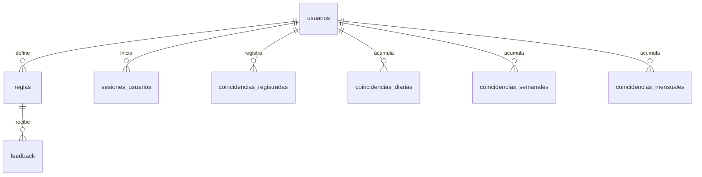

# ModerAI · Proyecto final de base de datos

ModerAI permite definir reglas en lenguaje natural y filtrar publicaciones en X. El sistema conserva cuentas, reglas, reportes y conteos de coincidencias en MySQL. La aplicación web permite administrar esos datos y consultar el historial de una cuenta. La extensión del navegador envía publicaciones al servicio de evaluación.

## Instalación y ejecución

1. Abre `ModerAI.slnx` en Visual Studio con .NET 10. El proyecto de inicio es `ModerAI.Web`.
2. Abre MySQL Workbench con una cuenta administradora y sigue el [orden de instalación en la carpeta db](../db/README.md#instalación-de-la-base-actual). El script 004 genera la contraseña de servicio.
3. En Visual Studio, abre **Administrar secretos de usuario** en `ModerAI.Web` y configura `ConnectionStrings:ModerAI`. Ejemplo de estructura con contraseña ficticia:

   ```json
   {
     "ConnectionStrings": {
       "ModerAI": "Server=127.0.0.1;Port=3306;Database=moderai_usuarios;User ID=moderai_dashboard;Password=REEMPLAZAR;SSL Mode=Required;"
     }
   }
   ```

   En Windows, el lanzador de Python lee la misma entrada `ConnectionStrings:ModerAI` en User Secrets. En ausencia de esa entrada, admite el archivo local anterior, DPAPI o la solicitud de la contraseña. Para un despliegue, suministra los secretos por configuración del servicio. Usa TLS verificado para MySQL remoto.
4. Inicia el modelo con `./scripts/Iniciar-Dashboard.ps1 -Modelo embeddings`. Este servicio escucha en 8001. Con F5 en Visual Studio, abre `http://127.0.0.1:5180/Dashboard`.
5. Carga o actualiza la extensión descomprimida desde `moderai-prototipo`. Inicia sesión en Dashboard y abre X con el mismo perfil del navegador. En una publicación visible puedes pulsar **Reportar contenido sin censurar** y elegir una regla activa. En una publicación revelada, **Reportar censura equivocada** abre el formulario con la regla aplicada.

## Arquitectura y operaciones

| Componente | Responsabilidad |
|---|---|
| ModerAI.Entidades | Tipos de usuario, regla, feedback, coincidencia y resumen. |
| ModerAI.Datos | Clase Conexion, acceso parametrizado con MySql.Data 26.10.0, vistas y procedimientos. |
| ModerAI.Negocios | Validación de filtros y formularios, permisos por titular y resolución de sesiones a partir de su huella. |
| ModerAI.Web | Razor Pages con vistas .cshtml y código .cshtml.cs. Configuración, reglas, actividad y feedback. |
| FastAPI y modelo Python | Conserva autenticación Argon2id y evalúa texto con el modelo. Los clientes de extensión llaman a la API de Dashboard. |
| Extensión Manifest V3 | Identifica publicaciones, reclama una evaluación y aplica el filtro dentro de X. |
| MySQL 8 | Persiste los datos, impone restricciones y ejecuta consultas y operaciones transaccionales. |

El registro y la autenticación se delegan a FastAPI para conservar los hashes Argon2id existentes. Dashboard toma la cuenta de la cookie protegida y de una sesión vigente en MySQL. Los formularios usan antifalsificación de ASP.NET Core y las operaciones restringen sus consultas al identificador de la cuenta autenticada. Las solicitudes de la extensión requieren el origen configurado y la sesión de Dashboard.

- Usuarios: registrar, consultar, editar nickname y certeza, eliminar la cuenta y sus dependencias.
- Reglas: crear, buscar y filtrar, editar texto, categoría, sensibilidad o estado, y borrar de forma lógica.
- Feedback: crear desde el formulario abierto por la extensión y administrar en Reportes. Los reportes del feed conservan el tipo, el texto de la publicación, la regla y un comentario opcional. La URL contiene únicamente el identificador del borrador temporal, que caduca a los 15 minutos. Dashboard muestra el historial.
- Coincidencias: reporte con filtros por período y fechas. La evaluación actualiza las tres series y deduplica por usuario, fecha UTC y huella. La eliminación de una cuenta también afecta varias tablas dentro de una transacción.
- El NIP es un control local del navegador. La autenticación y el aislamiento de cuentas se aplican en servidor.

| ID | Requisito funcional | Resultado visible |
|---|---|---|
| RF01 | Registrar una cuenta | Confirma el alta y abre Cuenta. |
| RF02 | Iniciar y cerrar sesión | Presenta la cuenta propia o el formulario de acceso. |
| RF03 | Editar nickname y nivel de certeza | Muestra la configuración y la sensibilidad calculada. |
| RF04 | Eliminar la cuenta propia | Confirma la eliminación transaccional y cierra la sesión. |
| RF05 | Crear una regla | Muestra la nueva regla activa. |
| RF06 | Editar, activar, desactivar y borrar una regla | Refleja sus cambios en el listado. |
| RF07 | Buscar reglas por texto, categoría y ausencia de reportes | Muestra los resultados filtrados. |
| RF08 | Registrar un reporte desde una publicación evaluada | Añade el reporte al historial. |
| RF09 | Consultar, editar y eliminar reportes propios | Actualiza el historial de Feedback. |
| RF10 | Consultar conteos por período y fechas | Muestra el historial y la gráfica de actividad. |
| RF11 | Evaluar publicaciones contra reglas activas | La extensión muestra la coincidencia y actualiza los conteos. |

## Reglas de negocio y diagrama lógico

1. El nickname identifica una cuenta de manera única.
2. La contraseña se verifica con su hash.
3. Cada regla tiene exactamente un dueño.
4. Una regla participa en la evaluación de su dueño si está activa y tiene la sensibilidad seleccionada en la cuenta.
5. Una regla borrada conserva sus reportes y queda fuera de futuras evaluaciones.
6. Cada reporte corresponde a una regla del usuario que lo crea.
7. Una sesión pertenece a una cuenta y expira en la fecha registrada.
8. Cada usuario tiene como máximo un agregado por período y fecha inicial.
9. El mismo texto se cuenta una sola vez por usuario y día UTC.
10. Cada usuario guarda un umbral para Baja, Normal y Alta. La sensibilidad activa de la cuenta determina qué reglas se evalúan y qué umbral se aplica.



El lado dependiente tiene participación obligatoria mediante su FK. En el lado principal, cada cuenta puede existir sin reglas, sesiones o actividad, y cada regla puede existir sin reportes. Las tablas de coincidencias son dependientes e identifican sus filas por usuario y período. El [diccionario de datos](Diccionario.md) documenta tipos, nulabilidad y valores predeterminados.

| Notación | Archivo editable | Exportación |
|---|---|---|
| Crow's Foot | [SVG](diagramas/crow-foot.svg) | [PNG](diagramas/crow-foot.png) |
| Classic | [SVG](diagramas/classic.svg) | [PNG](diagramas/classic.png) |
| Connect to Columns | [SVG](diagramas/connect-to-columns.svg) | [PNG](diagramas/connect-to-columns.png) |
| UML | [SVG](diagramas/uml.svg) | [PNG](diagramas/uml.png) |
| IDEF1X | [SVG](diagramas/idef1x.svg) | [PNG](diagramas/idef1x.png) |

Crow's Foot es la notación principal para el informe porque distingue de un vistazo el extremo obligatorio y la participación opcional. Connect to Columns facilita la revisión de las columnas de las claves. IDEF1X distingue las relaciones identificadoras de las cuatro tablas de conteos y deduplicación. [Notaciones de MySQL Workbench](https://dev.mysql.com/doc/workbench/en/wb-data-modeling-menus.html)

## Dependencias y normalización

- Una estructura plana que guarda usuario, regla, reporte y conteo en una misma fila repite los datos de la cuenta por cada combinación. Cambiar el nickname puede dejar copias inconsistentes. Borrar la única regla puede perder la cuenta y registrar una cuenta vacía requeriría datos ficticios de regla.
- 1FN. En el modelo relacional cada campo contiene un valor y las reglas, sesiones, reportes y conteos se representan como filas.
- 2FN. En las tablas con clave compuesta, el total depende del par completo (usuario, fecha inicial). En la deduplicación la clave incluye el usuario, el día y la huella.
- 3FN. `id_usuario` determina los datos propios de la cuenta; `id_regla` determina su configuración y dueño. `feedback` referencia la regla y obtiene el dueño por esa relación. Las columnas virtuales `nivel_sensibilidad` y `nivel_certeza` exponen el perfil activo y su umbral.
- Para BCNF se consideran los atributos base. Los determinantes de las dependencias descritas son claves candidatas, incluido el nickname único en usuarios. La proyección incluye el perfil activo y el umbral calculado a partir de la configuración de la cuenta.
- El análisis de 4FN considera reglas y sesiones como colecciones independientes de cada usuario, representadas en sus tablas. Para 5FN no se identificó una dependencia de reunión adicional que justifique dividir las tablas del esquema.
- Los tres agregados de actividad guardan métricas resumidas con retenciones distintas. El servicio los actualiza conjuntamente para evitar discrepancias.

## Álgebra relacional y consultas

En las expresiones, σ selecciona filas, π proyecta columnas y ⋈ representa una reunión. Se usa álgebra extendida para las agrupaciones.

| Consulta | Expresión |
|---|---|
| Reglas activas | σ activa = 1 ∧ fecha_borrado es NULL (reglas) |
| Nombre y certeza | π nickname, nivel_certeza (usuarios) |
| Regla y dueño | π nickname, texto_regla (usuarios ⋈ por id_usuario reglas) |
| Reportes y regla | π texto_regla, texto_feedback (reglas ⋈ por id_regla feedback) |
| Cuentas sin reglas | π id_usuario (usuarios) − π id_usuario (reglas) |
| Actividad por usuario | agrupar por id_usuario y sumar total_coincidencias (coincidencias_diarias) |

[09_consultas.sql](../db/consultas/09_consultas.sql) contiene diez consultas numeradas, ejemplos que consumen las dos vistas y una llamada a la función. Configura `@id_usuario` al inicio del script para las consultas que filtran por cuenta.

## Automatización y pruebas

| Mecanismo | Evento y efecto |
|---|---|
| trg_regla_borrado | Antes de actualizar una regla, impide reactivar o cambiar la marca de una regla borrada. |
| trg_feedback_regla_disponible | Antes de insertar un reporte, bloquea reglas borradas. |
| fn_umbral_regla | Devuelve el umbral configurado para la sensibilidad solicitada. |
| sp_registrar_feedback | Comprueba dueño y vigencia de la regla, valida el texto y registra el reporte con manejo de errores. |
| sp_eliminar_cuenta | Elimina reportes, reglas, actividad, sesiones y cuenta dentro de una transacción. Ante un error revierte el flujo. |

Los siguientes casos documentan la verificación realizada en una base temporal. Para repetirlos manualmente, prepara una instancia local con los scripts de instalación y crea cuentas mediante el Dashboard.

| Caso SQL | Entrada o acción | Resultado esperado |
|---|---|---|
| 1 | Registrar cuenta con certeza 50 | La sensibilidad es Baja. |
| 2 | Repetir el nickname | MySQL rechaza el duplicado. |
| 3 | Insertar regla con dueño inexistente | MySQL rechaza la FK. |
| 4 | Reportar una regla ajena | El procedimiento rechaza el reporte. |
| 5 | Reportar una regla propia | La vista devuelve el reporte de la cuenta. |
| 6 | Consultar los tres perfiles con umbrales 47, 63 y 82 | La función devuelve el valor configurado para cada perfil. |
| 7 | Reactivar una regla borrada | El trigger bloquea el cambio. |
| 8 | Reportar una regla borrada | El trigger bloquea el reporte. |
| 9 | Cambiar certeza dentro de una transacción y revertir | Se conserva la certeza original. |
| 10 | Ejecutar la eliminación de la cuenta de prueba | Desaparecen la cuenta y sus dependencias. |

La ejecución en MySQL 8.0.46 devolvió los diez casos aprobados. La prueba HTTP verificó los tres CRUD, los filtros, la separación entre dos cuentas, el rechazo del origen inválido y el conteo único tras dos evaluaciones del mismo texto. También reinició Dashboard y recuperó las reglas y el feedback persistidos.

| Incidencia observada | Corrección y comprobación |
|---|---|
| La versión web anterior podía combinar scripts en caché y perder el botón de guardado. | Los formularios Razor generan solicitudes directas. El CSS y JavaScript usan huellas de versión para sus recursos. |
